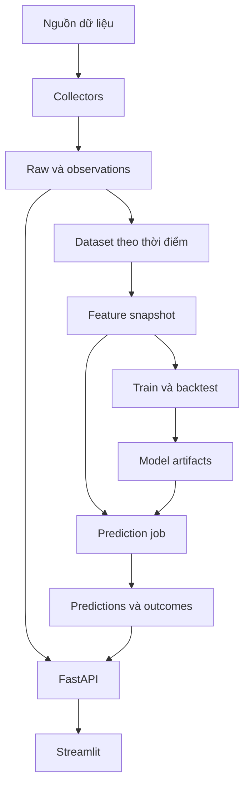

# Kiến trúc GoldScope

**Trạng thái:** thiết kế mục tiêu v1.0; ứng dụng chưa được bootstrap. Chi tiết công nghệ ở reference/GOLDSCOPE_TECHNOLOGY_STACK.md.

## 1. Phạm vi

Một repository, một package `goldscope`, database PostgreSQL và file artifacts. Tiến trình API, dashboard, batch job tách nhau nhưng dùng chung domain code. Chưa cần service độc lập có database riêng, message broker hoặc LLM.

## 2. Module và ranh giới

| Đường dẫn dự kiến | Sở hữu | Không chịu trách nhiệm |
|---|---|---|
| `src/goldscope/core/` | Settings, logging, exceptions, time policy | Không chứa API keys hard-code |
| `collectors/` | Request nguồn, response validation, raw metadata | Không tạo feature hoặc train |
| `data/` | Normalize, quality, vintages, snapshots | Không render UI |
| `features/` | Feature và target từ đầu vào đã chọn đúng thời điểm | Không tự truy cập Internet |
| `ml/` | Baseline, fit, evaluate, interval, predict | Không gắn vào route handler |
| `db/` | ORM tables, repositories, sessions/transactions | Không chọn mô hình |
| `services/` | Điều phối use case, transaction boundaries | Không lặp lại công thức feature |
| `api/` | Router, schema, error translation, HTTP | Không collect/train trong GET |
| `jobs/` | Daily, retrain, backfill, score entry points | Không có bản feature logic riêng |
| `cli.py` | Typer commands gọi service/job | Không giữ nghiệp vụ trong CLI |
| `dashboard/` | API client và trình bày | Không truy cập DB hoặc key nguồn trực tiếp |

Hướng phụ thuộc: entry point → service → domain/data/ML/repository. Module cấp thấp không import router/CLI/dashboard. Truyền client/session/settings vào thành phần cần dùng để kiểm thử được bằng fake/mocks.

## 3. Luồng ingest

Lấy job lock → tạo ingestion run → HTTP request → lưu raw/checksum → normalize/validate → transaction ghi observations/revisions → quality summary → kết thúc run.

Raw payload có thể đã lưu trước transaction database. Nếu transaction thất bại, ghi rõ run thất bại và xử lý raw mồ côi bằng retention; không coi file raw tồn tại là ingest thành công. Không giữ transaction database mở trong lúc chờ network lâu.

Unique key + upsert có chủ đích bảo vệ retry/concurrency. Không dùng “SELECT rồi INSERT” thiếu unique constraint làm cơ chế chống trùng duy nhất.

## 4. Luồng nghiên cứu

Snapshot cố định → dữ liệu hợp lệ theo từng origin → feature + target → các cửa sổ train/validation → predictions ngoài mẫu → metrics/manifest → model candidate. Final holdout được khóa trước khi tune.

Code feature và schema validation dùng chung cho nghiên cứu/live. Data provider adapters chỉ tham gia ingest, không được gọi trong từng fold.

## 5. Luồng forecast live

Job chọn model active theo asset/horizon, lấy đầu vào theo cutoff, kiểm tra freshness/feature schema rồi predict. Ghi forecast trong transaction với khóa chống trùng. Job score riêng bổ sung outcomes khi có dữ liệu đích. Một forecast đã phát hành không bị sửa nội dung.

Nếu dữ liệu quá cũ, model không tương thích hoặc target không còn ở tương lai: không tạo forecast live mới. Có thể tạo backfill nghiên cứu với `mode=backtest`, phải tách khỏi lịch sử live.

## 6. Luồng hiển thị

Dashboard dùng FastAPI đọc giá, forecasts, outcomes, performance và quality. Cache UI phải theo model/data version hoặc TTL có chủ đích và luôn hiển thị timestamp dữ liệu. API không gọi nhà cung cấp mỗi lần người dùng tải trang.

Hiển thị point forecast tại horizon cuối, không bịa đường đi trung gian. Tách synthetic demo/live/backtest; interval có mức danh nghĩa và performance ngoài mẫu. Không tự đổi null thành số 0.

## 7. Transaction, thời gian và tương thích

- SQLAlchemy sync là lựa chọn đầu; dùng endpoint/service phù hợp với IO blocking.
- UTC cho timestamp tuyệt đối, `date` cho observation date. Provider timezone/calendar là metadata riêng.
- Migration là nguồn schema thực tế khi đã có code. Không dùng `create_all` để thay migration trên deploy.
- Model manifest chứa feature schema hash; từ chối artifact không tương thích thay vì tự sắp/xóa feature ngầm.
- Dữ liệu và schema/API có version. Breaking change cần migration/ADR và client test.

## 8. Kiến trúc vận hành

Compose: `db`, `api`, `dashboard`, `job` one-shot. Một scheduler ngoài API gọi job. API/dashboard thường trực; training chạy theo nhu cầu và có giới hạn tài nguyên. Proxy/TLS được chọn trước deploy; ADR-0005 còn proposed.

Readiness kiểm tra khả năng phục vụ phụ thuộc, không dùng ngày nghỉ của nguồn để gây restart loop. Freshness có trạng thái riêng. Logging dùng run_id/request_id; không ghi URL chứa API key.

## 9. Những thay đổi phải có quyết định

Tách service; thay provider/tài sản; thay horizon/target; thêm queue/LLM; thay database; đổi API breaking; thay chính sách thời điểm; đổi giao thức đánh giá chính. Ghi ADR và cập nhật task/contracts liên quan trước khi dùng kết quả mới.
