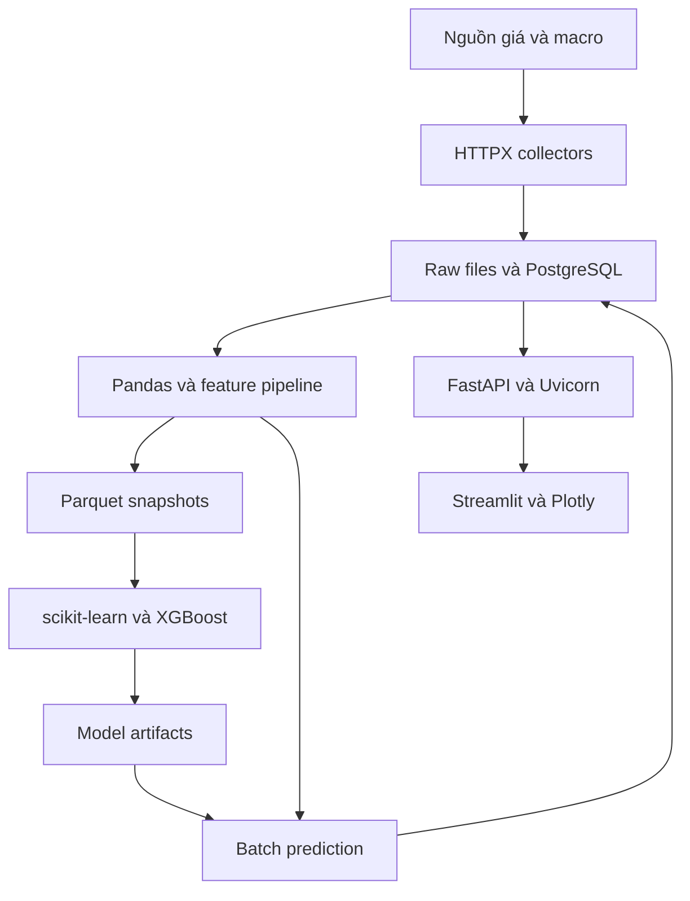

# GoldScope — Tổng hợp ngôn ngữ, công nghệ, công cụ và tài nguyên dự án

> **Dự án:** GoldScope — Gold Market Intelligence & Forecasting Platform  
> **Chủ dự án:** Nguyễn Duy Khánh  
> **Ngày cập nhật:** 30/09/2026  
> **Phiên bản tài liệu:** 1.0  
> **Phạm vi:** Từ Lab 00 đến bản portfolio v1.0, kèm các hướng nâng cấp sau đó.

Tài liệu này trả lời: dùng ngôn ngữ gì, framework nào, thư viện nào, cần cài phần mềm gì, đăng ký tài khoản nào và chuẩn bị những gì để hoàn thành GoldScope. Nội dung đồng bộ với `GOLDSCOPE_PROJECT_GUIDE.md` và kết quả `GOLDSCOPE_LAB00_DATA_SOURCE_AUDIT.md`.

**Trạng thái thực tế:** hiện đã có tài liệu thiết kế, công cụ audit Lab 00 bằng Python standard library và 12 kiểm thử đạt. Lab 00 còn chờ API key của dự án và kiểm chứng dữ liệu vàng. Backend, dashboard, database, pipeline ML và triển khai v1.0 vẫn là công việc dự kiến, chưa được cài đặt/xây dựng hoàn chỉnh trong dự án.

## Mục lục

1. [Bộ công nghệ tổng thể](#s01)
2. [Ngôn ngữ và định dạng](#s02)
3. [Framework và thành phần ứng dụng](#s03)
4. [Nguồn dữ liệu và thu thập](#s04)
5. [Database và lưu trữ](#s05)
6. [Xử lý dữ liệu và machine learning](#s06)
7. [Dashboard và giao tiếp hệ thống](#s07)
8. [Môi trường và công cụ lập trình](#s08)
9. [Kiểm thử và chất lượng mã nguồn](#s09)
10. [Tự động hóa, Docker và CI/CD](#s10)
11. [Triển khai, bảo mật và vận hành](#s11)
12. [Tài khoản, khóa truy cập và phần cứng](#s12)
13. [Danh mục dependency và quản lý phiên bản](#s13)
14. [Công nghệ theo từng lab](#s14)
15. [Công nghệ mở rộng tùy chọn](#s15)
16. [Kiến thức cần học để sử dụng stack](#s16)
17. [File cấu hình và tài liệu cần bàn giao](#s17)
18. [Checklist chuẩn bị và hoàn thành](#s18)
19. [Nguồn tham khảo chính thức](#s19)

<a id="s01"></a>
## 1. Bộ công nghệ tổng thể

### 1.1. Cách đọc mức độ cần thiết

| Nhãn | Ý nghĩa |
|---|---|
| **Cốt lõi** | Đã chọn trong thiết kế, cần cho bản ứng dụng v1.0 theo phạm vi đã chốt |
| **Theo giai đoạn** | Cần khi triển khai phần chức năng tương ứng, chưa phải cài ngay ở Lab 00 |
| **Đề xuất bổ sung** | Lựa chọn cụ thể giúp hoàn thiện vận hành; cần ghi quyết định khi triển khai |
| **Tùy chọn** | Hữu ích nhưng không phải điều kiện hoàn thành v1.0 |
| **Chờ kiểm chứng** | Chưa thể chốt vì thiếu dữ liệu, quyền truy cập hoặc kết quả đo |

“Cốt lõi” là mức ưu tiên trong kế hoạch, không có nghĩa đã sử dụng trong mã nguồn hiện tại. v1.0 cần hệ thống dự báo, API, dashboard, đánh giá và vận hành; không yêu cầu cài mọi công cụ trong phần mở rộng.

### 1.2. Bảng tổng quan

| Lớp | Công nghệ chọn | Chức năng trong GoldScope | Mức độ |
|---|---|---|---|
| Ngôn ngữ chính | Python 3.12 | API, collector, xử lý dữ liệu, ML, dashboard, CLI | Cốt lõi |
| Truy vấn | SQL | Truy vấn và kiểm tra dữ liệu PostgreSQL | Cốt lõi |
| Backend framework | FastAPI | Cung cấp REST API cho thị trường, dự báo và model | Cốt lõi |
| API server | Uvicorn | Chạy ứng dụng FastAPI theo giao diện ASGI | Cốt lõi |
| Schema/config | Pydantic v2, pydantic-settings | Kiểm tra dữ liệu, đọc cấu hình môi trường | Cốt lõi |
| HTTP client | HTTPX | Gọi API bên ngoài và gọi API từ dashboard | Cốt lõi |
| Database | PostgreSQL 17 | Observations, runs, model metadata, predictions, outcomes | Cốt lõi |
| ORM | SQLAlchemy 2.x | Giao tiếp ứng dụng với database | Cốt lõi |
| DB driver | Psycopg 3 | Kết nối Python–PostgreSQL | Cốt lõi |
| Migration | Alembic | Quản lý thay đổi schema database | Cốt lõi |
| Xử lý dữ liệu | Pandas, NumPy | Chuẩn hóa, ghép chuỗi, tạo feature và tính toán | Cốt lõi |
| Snapshot dữ liệu | PyArrow + Parquet | Lưu dataset/feature phục vụ tái lập thí nghiệm | Cốt lõi |
| Machine learning | scikit-learn, XGBoost | Baseline, Ridge, model cây, quantile và metrics | Cốt lõi |
| Dashboard framework | Streamlit | Giao diện tương tác viết bằng Python | Cốt lõi |
| Biểu đồ | Plotly | Giá, lợi suất, khoảng dự báo, so sánh model | Cốt lõi |
| CLI | Typer | Lệnh collect, build dataset, train, predict, score | Cốt lõi |
| Dependency manager | uv | Môi trường Python và lockfile | Cốt lõi |
| Test | pytest, pytest-cov, respx | Unit, integration, temporal tests, mock HTTP | Cốt lõi |
| Chất lượng code | Ruff, mypy | Format/lint và kiểm tra kiểu tĩnh | Cốt lõi |
| Version control | Git + GitHub | Lịch sử source, issue, review, release | Cốt lõi |
| Container | Docker + Docker Compose | Chạy các tiến trình ứng dụng và database nhất quán | Cốt lõi |
| CI/CD | GitHub Actions | Kiểm thử, build và triển khai theo workflow | Theo giai đoạn |
| Scheduler | systemd timer hoặc cron | Chạy daily pipeline và lịch retrain | Theo giai đoạn |
| Triển khai cá nhân | Một máy chủ Linux | Chạy demo lâu dài | Theo giai đoạn |
| HTTPS/reverse proxy | Caddy, hoặc Nginx theo quyết định triển khai | Đưa API/dashboard ra Internet | Đề xuất bổ sung |

Python 3.12 và PostgreSQL 17 là lựa chọn nền tảng trong kế hoạch, không phải tuyên bố phiên bản mới nhất. Phiên bản patch của các gói chỉ được chốt sau khi cài, kiểm thử và tạo `uv.lock`.

### 1.3. Quan hệ giữa các thành phần



Kiến trúc là một ứng dụng chia module trong cùng repository. API, dashboard và batch job có thể chạy thành các tiến trình/container riêng nhưng dùng chung source và contract; chưa cần microservices.

<a id="s02"></a>
## 2. Ngôn ngữ và định dạng

| Thành phần | Loại | Sử dụng ở đâu | Mức kiến thức cần |
|---|---|---|---|
| Python | Ngôn ngữ lập trình | Phần lớn ứng dụng | Hàm, module, typing, exception, OOP vừa đủ, package, test |
| SQL | Ngôn ngữ truy vấn | Database, báo cáo, kiểm tra dữ liệu | JOIN, GROUP BY, index, transaction, constraint |
| Bash | Ngôn ngữ shell | Linux/WSL, script vận hành | Lệnh file, biến môi trường, exit code, quoting |
| PowerShell | Shell trên Windows | Khởi động tool và môi trường nếu dùng Windows | Lệnh cơ bản; không bắt buộc nếu làm trong WSL |
| YAML | Định dạng cấu hình | Compose, GitHub Actions, cấu hình thí nghiệm | Hiểu cấu trúc, thụt dòng và kiểu dữ liệu |
| TOML | Định dạng cấu hình | `pyproject.toml`, cấu hình tooling | Khai báo dependency và nhóm cấu hình |
| JSON | Định dạng trao đổi dữ liệu | API, manifest, metadata, audit report | Object, array, null, quy ước kiểu |
| Markdown | Định dạng tài liệu | README, hướng dẫn, ADR, báo cáo | Heading, bảng, code block, link |
| Dockerfile | Ngôn ngữ chỉ thị build image | Đóng gói ứng dụng | FROM, COPY, RUN, CMD, layer, non-root user |
| Parquet | Định dạng file dữ liệu dạng cột | Snapshot dataset và feature | Biết schema, kiểu cột, đọc/ghi qua PyArrow |

Không cần viết frontend bằng JavaScript/TypeScript để hoàn thành giao diện Streamlit. HTML/CSS chỉ cần khi thật sự tùy biến giao diện; React, Flutter, Java và Spring Boot không nằm trong stack GoldScope v1.0. Điều này độc lập với dự án giao hàng bạn đang làm.

<a id="s03"></a>
## 3. Framework và thành phần ứng dụng

### 3.1. FastAPI — framework backend chính

FastAPI dùng để tạo API từ ứng dụng Python [R01]. Trong GoldScope, các route sẽ trả lịch sử giá, forecast, model performance và trạng thái chất lượng dữ liệu.

Ví dụ các nhóm API dự kiến:

- `/api/v1/market/*`
- `/api/v1/forecasts/*`
- `/api/v1/models/*`
- `/api/v1/data-quality`
- `/health/live` và `/health/ready`

FastAPI cũng cung cấp OpenAPI và trang tài liệu tương tác. API đọc kết quả đã lưu; không train model trong một request tải trang.

### 3.2. Các thành phần hỗ trợ backend

| Thành phần | Phân loại | Tác dụng | Cách sử dụng dự kiến |
|---|---|---|---|
| Uvicorn | ASGI server | Nhận request và chạy ứng dụng FastAPI | Chạy local, container và production |
| Pydantic | Thư viện validation | Định nghĩa schema input/output và kiểm tra kiểu | Query, response, cấu hình nghiệp vụ |
| pydantic-settings | Thư viện quản lý settings | Nạp cấu hình từ môi trường và `.env` khi được cấu hình | Database URL, API keys, đường dẫn dữ liệu [R05] |
| HTTPX | HTTP client | Gọi dịch vụ ngoài; timeout và quản lý kết nối | Collector và dashboard API client [R06] |
| Typer | Framework CLI | Tạo lệnh quản trị có tham số/help | Collect, backtest, predict, daily job |

Uvicorn không phải framework nghiệp vụ; Pydantic không phải database; HTTPX không phải web server. Việc hiểu đúng vai trò giúp tránh cài nhiều công cụ trùng chức năng.

### 3.3. Streamlit — framework giao diện

Streamlit tạo dashboard từ Python [R02]. Người dùng chọn thời gian, horizon, xem biểu đồ và đọc kết quả đánh giá. Giao diện gọi FastAPI để lấy dữ liệu đã chuẩn bị.

### 3.4. Framework kiểm thử

pytest là framework kiểm thử chính cho ứng dụng. Lab 00 hiện dùng `unittest` có sẵn trong Python để chạy độc lập. Khi đưa vào repo chính, giữ hành vi các test hiện có và tổ chức lại phù hợp với pytest; không cần xóa chúng chỉ vì đổi test runner.

<a id="s04"></a>
## 4. Nguồn dữ liệu và thu thập

### 4.1. Dịch vụ ngoài cần kết nối

| Nguồn | Mục đích | Cần chuẩn bị | Trạng thái |
|---|---|---|---|
| Alpha Vantage | Ứng viên nguồn lịch sử giá vàng | API key và quyền endpoint/lịch sử phù hợp | Chờ kiểm chứng bằng key dự án |
| FRED/ALFRED thông qua cơ chế vintage | Lợi suất, USD, lãi suất, CPI và lịch sử phiên bản | FRED API key; chính sách thời điểm sử dụng từng series | Đã chọn nguồn, chưa kiểm chứng tài khoản dự án |
| News API, ưu tiên khảo sát Alpha Vantage | Tin tức/relevance/sentiment | Quyền truy cập, timestamp và độ phủ lịch sử | Chỉ triển khai ở Lab 09 khi đủ điều kiện |

API vàng ứng viên là `GOLD_SILVER_HISTORY`, `symbol=GOLD`, `interval=daily`. Các macro ưu tiên là `DGS10`, `DFII10`, `DTWEXBGS`; `DFF`, `CPIAUCSL`, `DCOILWTICO` được khảo sát sau. Nguồn và key không tự bảo đảm đúng đơn vị, đầy đủ lịch sử hoặc quyền tái phân phối; các mục này thuộc source audit.

### 4.2. Công nghệ collector

| Nhu cầu | Giải pháp |
|---|---|
| Gọi API | HTTPX trong ứng dụng chính |
| Công cụ kiểm chứng độc lập hiện có | `urllib.request`, `json`, `argparse`, `getpass` của Python |
| Chuẩn hóa dữ liệu | Python + Pydantic/Pandas tùy lớp xử lý |
| Retry/backoff | Logic giới hạn retry trong collector; Tenacity chỉ thêm nếu logic đủ phức tạp |
| Giới hạn tốc độ | Cấu hình theo quota nguồn; không gọi lại theo từng lượt mở dashboard |
| Phát hiện trùng | Business key, unique constraint, hash nội dung |
| Theo dõi ingestion | Bảng run/status và structured logs |
| Chứng minh nguồn gốc | Raw snapshot, checksum SHA-256 và manifest |

Không cần Selenium, Playwright hoặc BeautifulSoup để gọi các REST API đã chọn. Nếu về sau bắt buộc thu thập từ website, phải audit nguồn và quyền truy cập trước khi thêm một công cụ scraping.

### 4.3. Những dữ liệu bắt buộc phải biết

Ngoài giá trị số, cần lưu hoặc xác định: đơn vị, tiền tệ, ngày quan sát, thời điểm công bố/sẵn sàng, thời điểm thu nhận, vintage/revision, source ID và quy tắc lịch phiên.

Các thư viện không tự giải quyết leakage. Quy tắc `available_at <= as_of`, xử lý revision và kiểm tra nhãn đã trưởng thành là logic GoldScope phải tự xây dựng.

<a id="s05"></a>
## 5. Database và lưu trữ

### 5.1. Bộ công nghệ database

| Công nghệ | Vai trò | Vì sao cần |
|---|---|---|
| PostgreSQL 17 | Hệ quản trị cơ sở dữ liệu | Lưu quan sát, trạng thái job và lịch sử dự báo nhất quán |
| SQLAlchemy 2.x | ORM và SQL toolkit | Tổ chức query, transaction, model database [R07] |
| Psycopg 3 | Driver PostgreSQL | Kết nối ORM/Python với PostgreSQL [R09] |
| Alembic | Database migration | Tạo/thay đổi bảng có lịch sử phiên bản [R08] |
| `psql` | CLI PostgreSQL | Kiểm tra và vận hành database |
| DBeaver hoặc pgAdmin | Giao diện database tùy chọn | Xem bảng/query thuận tiện; chỉ cần chọn một |

Database có thể chạy trong container ngay từ giai đoạn phát triển. Khi chọn cách này, không cần cài thêm một PostgreSQL server khác trên Windows nếu không có nhu cầu.

### 5.2. Phân công lưu trữ

| Dữ liệu | Nơi lưu v1.0 | Công nghệ đọc/ghi |
|---|---|---|
| Giá/macro chuẩn hóa | PostgreSQL | SQLAlchemy + Psycopg |
| Ingestion runs, quality events | PostgreSQL | SQLAlchemy |
| Predictions và outcomes | PostgreSQL | SQLAlchemy |
| Model registry metadata | PostgreSQL | SQLAlchemy |
| Raw response | Thư mục/volume riêng, JSON hoặc JSON nén | `json`, `gzip`, `pathlib` |
| Dataset và feature snapshot | File Parquet | Pandas + PyArrow [R11] |
| Model XGBoost | Artifact native JSON/UBJSON theo phiên bản dùng | XGBoost |
| Pipeline scikit-learn | Artifact nội bộ có kiểm soát | Có thể dùng joblib; khai báo trực tiếp nếu import |
| Manifest và metrics | JSON; registry lưu đường dẫn/hash | `json`, `hashlib` |
| Báo cáo nghiên cứu | Markdown, CSV, biểu đồ | Python + Plotly |

Artifact serialized chỉ được nạp từ nguồn do dự án kiểm soát. Model phải đi kèm feature schema, version thư viện, data hash và git SHA. Model file lớn/raw data không đưa trực tiếp vào lịch sử Git.

### 5.3. Backup

`pg_dump`/`pg_restore` là bộ công cụ dự kiến cho sao lưu và khôi phục database [R19]. Artifact/model/raw cần kế hoạch sao lưu riêng vì không nằm hoàn toàn trong PostgreSQL. Bản backup phải được thử restore trước release, đồng thời giữ một bản ở nơi khác với ổ đĩa đang vận hành.

Object storage tương thích S3 là lựa chọn mở rộng khi cần; một bản sao trên ổ đĩa/host khác cũng có thể đáp ứng giai đoạn cá nhân nếu được quản lý phù hợp.

<a id="s06"></a>
## 6. Xử lý dữ liệu và machine learning

### 6.1. Thư viện chính

| Thư viện | Vai trò trong dự án | Thời điểm |
|---|---|---|
| Pandas | Làm sạch, align time series, rolling features, kiểm tra missing [R10] | Lab 03–04 |
| NumPy | Mảng số, biến đổi và phép tính metrics | Lab 03–04 |
| PyArrow | Đọc/ghi Parquet và schema dữ liệu | Lab 03 |
| scikit-learn | Ridge, preprocessing, time split, metrics [R12] | Lab 04 |
| XGBoost | Model phi tuyến và quantile regression [R13] | Lab 05 |
| Plotly | Biểu đồ EDA và kết quả | Lab 03, Lab 07 |
| JupyterLab + ipykernel | Môi trường notebook cho EDA | Đề xuất cho phát triển, không chạy trong production |
| SHAP | Giải thích model | Tùy chọn sau khi backtest ổn |

### 6.2. Thuật toán và kỹ thuật cần triển khai

Các mục dưới là phương pháp, không phải mỗi mục cần cài một framework:

| Phương pháp | Vai trò | Công nghệ thực hiện |
|---|---|---|
| Zero-return baseline | Dự báo lợi suất bằng 0, giá bằng giá origin | Hàm Python |
| Ridge regression | Ứng viên tuyến tính | scikit-learn |
| Gradient boosted trees | Ứng viên phi tuyến | XGBoost |
| Quantile regression | Khoảng q10–q90 với mức danh nghĩa 80% | XGBoost phiên bản hỗ trợ |
| Rolling/lags/momentum/volatility | Tạo feature từ lịch sử hợp lệ | Pandas/NumPy |
| Walk-forward validation | Mô phỏng train/predict theo thời gian | Code điều phối + công cụ split |
| Gap và label-availability checks | Ngăn mẫu train có nhãn chưa biết | Logic thời gian và temporal tests |
| Ablation | Đo đóng góp của macro/tin tức | Cấu hình experiment và báo cáo |
| MAE, RMSE, baseline skill | Đánh giá point forecast | scikit-learn/NumPy |
| Pinball loss, coverage, interval width | Đánh giá khoảng dự báo | scikit-learn/NumPy/code riêng |

Mô hình đầu dùng horizon 1 và 5 phiên dữ liệu; 20 phiên là mở rộng. Deep learning và xác suất tăng/giảm không phải yêu cầu bắt buộc của MVP.

### 6.3. Cần gì để tái lập thí nghiệm?

- Snapshot dữ liệu bất biến và hash.
- Cấu hình feature và time policy có version.
- Train/validation/holdout periods được chốt.
- Random seed, hyperparameters và phiên bản thư viện.
- Prediction từng origin, metrics từng fold và manifest model.
- Mã nguồn có commit SHA.

Ban đầu dùng file manifest và database để quản lý. MLflow hữu ích khi số lượng experiment tăng; không bắt buộc dựng một MLflow server từ ngày đầu.

<a id="s07"></a>
## 7. Dashboard và giao tiếp hệ thống

| Thành phần | Công nghệ | Kết quả người dùng thấy |
|---|---|---|
| Các trang ứng dụng | Streamlit | Tổng quan, lịch sử, dự báo, performance, data quality |
| Biểu đồ | Plotly | Đường giá, lợi suất, khoảng dự báo, bảng so sánh |
| Gọi backend | HTTPX | Dữ liệu nhất quán với API |
| Giao tiếp ứng dụng | REST trên HTTP/HTTPS + JSON | Hợp đồng dữ liệu rõ ràng |
| Mô tả API | OpenAPI | Schema endpoint và input/output |
| Thử API thủ công | Swagger UI có trong FastAPI, hoặc `curl` | Thử request và xem response |
| Thử API nâng cao | Postman hoặc Bruno | Tùy chọn, không cần cài cả hai |

Dashboard phải thể hiện source, thời điểm cập nhật, horizon, model version và trạng thái stale/unavailable. Prediction interval không được đổi nhãn thành “độ chắc chắn AI”. Dữ liệu demo tổng hợp phải có nhãn riêng.

Không cần WebSocket cho luồng cập nhật một lần mỗi ngày. Có thể bổ sung khi bài toán thật sự chuyển sang cập nhật liên tục.

<a id="s08"></a>
## 8. Môi trường và công cụ lập trình

### 8.1. Phần mềm trên máy phát triển

| Công cụ | Mục đích | Yêu cầu |
|---|---|---|
| VS Code | Soạn code, debug, terminal và Git | Đề xuất dùng thống nhất |
| Python 3.12 | Runtime Python của dự án | Cần |
| uv | Quản lý environment/dependency [R03] | Cần từ Lab 01 |
| Git | Commit, branch, tag | Cần từ Lab 01 |
| Docker + Compose | Chạy PostgreSQL và ứng dụng container | Cần trong lộ trình |
| Trình duyệt | Mở dashboard, API docs, tài liệu | Cần |
| WSL2 + Linux trên Windows | Môi trường gần máy chủ Linux | Đề xuất nếu dùng Windows |
| Docker Desktop trên Windows | Cách cung cấp Docker cho môi trường Windows/WSL | Chọn theo máy và điều kiện sử dụng |
| Docker Engine trên Linux | Docker runtime khi dùng Linux trực tiếp/VPS | Theo môi trường |

Chọn một môi trường Python chính. Không dùng chung `.venv` giữa Windows và WSL. uv tạo/quản lý virtual environment nên không cần thêm Conda hoặc Poetry cho cùng repository.

### 8.2. Extension VS Code đề xuất

| Extension/nhóm | Vai trò |
|---|---|
| Python | Debug và hỗ trợ Python |
| Pylance | Gợi ý kiểu và điều hướng code |
| Ruff | Format/lint trong editor |
| Jupyter | Mở notebook EDA khi dùng notebook |
| WSL | Làm việc trong WSL khi phát triển trên Windows |

Extension database, Docker hoặc Git bổ sung theo nhu cầu; không phải điều kiện để code chạy. Kiểm tra đúng publisher trước khi cài.

### 8.3. Quản lý công việc

GitHub Issues/Projects hoặc một bảng checklist trong repo đủ để quản lý Lab 00–10. Không bắt buộc dùng Jira, Notion hoặc thêm một dịch vụ quản lý riêng cho dự án cá nhân.

<a id="s09"></a>
## 9. Kiểm thử và chất lượng mã nguồn

| Công cụ | Vai trò | Nhóm cài đặt |
|---|---|---|
| pytest | Unit/integration/temporal tests | Development |
| pytest-cov | Báo cáo coverage | Development |
| respx | Mock request HTTPX, không tiêu quota API thật | Development |
| Ruff | Format và lint [R15] | Development |
| mypy | Kiểm tra type hints [R16] | Development |
| PostgreSQL test instance | Kiểm tra SQL/migration đúng engine | Docker/CI service |
| unittest | Test độc lập Lab 00 hiện tại | Có sẵn trong Python |
| Locust hoặc k6 | Đo tải khi cần xác minh hiệu năng | Tùy chọn; chọn một |

pytest cung cấp nền tảng tổ chức và chạy test [R14]. Những hành vi GoldScope cần kiểm chứng gồm: lỗi quota, body lỗi trong HTTP 200, chạy lại không trùng, date/number sai, feature không nhìn tương lai, nhãn train đã trưởng thành, model đúng schema và API không che giấu dữ liệu stale.

Không coi coverage cao là bằng chứng chống leakage. Một số temporal tests có giá trị lớn hơn nhiều test chỉ lặp lại công thức triển khai.

CI mặc định dùng fixture và mock. Test với nguồn thật tách riêng, chạy khi có key và có ngân sách request.

<a id="s10"></a>
## 10. Tự động hóa, Docker và CI/CD

### 10.1. Chạy theo lịch

| Nhu cầu | Lựa chọn v1.0 | Mở rộng khi cần |
|---|---|---|
| Chạy collect/predict mỗi ngày | Một systemd timer hoặc cron gọi Typer CLI | Scheduler chuyên dụng |
| Tránh job trùng | PostgreSQL advisory lock hoặc bảng khóa | Vẫn phải giữ khi có queue |
| Ghi kết quả job | PostgreSQL ingestion runs + logging | Dashboard monitoring riêng |
| Retrain định kỳ | Job riêng, lịch dự kiến hàng tháng | Queue worker nếu nặng |

Ưu tiên systemd timer nếu máy chủ dùng systemd; cron là phương án thay thế, không chạy cả hai cho cùng một job. Mốc giờ cụ thể chờ kiểm chứng thời điểm dữ liệu sẵn sàng. Không tạo scheduler trong từng worker Uvicorn.

### 10.2. Docker và Compose

Compose khai báo và quản lý nhóm dịch vụ container [R17]. Thiết kế dự kiến:

| Service | Thành phần chạy | Có chạy thường trực? |
|---|---|---|
| `db` | PostgreSQL | Có |
| `api` | FastAPI + Uvicorn | Có |
| `dashboard` | Streamlit | Có |
| `job` | CLI collect/train/predict/score | Chạy khi được gọi |
| `proxy` | Reverse proxy/HTTPS nếu chọn chạy container | Khi deploy Internet |

Docker volume giữ database và artifacts. Container có thể được thay thế mà dữ liệu cần giữ vẫn tồn tại. Volume không tự thay thế backup.

### 10.3. GitHub Actions và image registry

GitHub Actions thực thi workflow test/build/deploy [R18]. Lộ trình CI: cài theo lockfile → format/lint/type checks → tests → migration smoke → build image. CD chỉ thực hiện sau khi có môi trường deploy và secret cấu hình.

**Đề xuất bổ sung:** dùng GitHub Container Registry (`ghcr.io`) để lưu image của repo [R20]. Đây là lựa chọn triển khai, chưa có registry/image thực tế được tạo. Docker Hub là phương án thay thế; không cần dùng đồng thời.

Image được gắn commit SHA/tag release. Rollback ứng dụng dùng image trước; rollback model dùng model version trước. Migration database cần chiến lược riêng, không giả định cứ chạy image cũ là database trở lại trạng thái cũ.

<a id="s11"></a>
## 11. Triển khai, bảo mật và vận hành

### 11.1. Hạ tầng hoàn thiện

| Hạng mục | Chức năng | Bắt buộc khi nào? |
|---|---|---|
| Máy chủ Linux/VPS | Chạy ứng dụng lâu dài | Khi cần demo online thường xuyên |
| Docker Engine + Compose | Chạy stack trên server | Theo phương án triển khai đã chọn |
| Reverse proxy | Định tuyến API/dashboard từ một đầu vào | Khi đưa dịch vụ ra Internet |
| HTTPS/TLS | Mã hóa kết nối | Khi cung cấp dịch vụ qua Internet |
| Domain/subdomain và DNS | Địa chỉ dễ dùng, phục vụ cấu hình HTTPS | Đề xuất cho demo online; tên miền riêng có thể chưa cần mua nếu có hostname phù hợp |
| SSH key | Truy cập và triển khai máy chủ | Nếu tự vận hành VPS |
| Firewall | Giới hạn cổng công khai | Khi vận hành máy chủ |
| Backup destination | Giữ bản sao ngoài nơi chạy | Trước release vận hành |

**Đề xuất cụ thể cho bản triển khai cá nhân:** Caddy làm reverse proxy vì có cơ chế quản lý HTTPS tự động khi hostname/DNS/network đáp ứng điều kiện [R21]. Nếu đã quen Nginx, có thể chọn Nginx cùng công cụ quản lý chứng chỉ. Chỉ chọn một giải pháp và ghi ADR trước khi triển khai; tài liệu này chưa thay đổi cấu hình ứng dụng.

### 11.2. Log và monitoring

| Mức | Công nghệ | Nội dung |
|---|---|---|
| Cốt lõi | Python `logging`, JSON log formatter của dự án | Run ID, request ID, lỗi nguồn, số dòng, thời gian |
| Cốt lõi | Bảng metrics/status trong PostgreSQL | Lần chạy cuối, freshness, outcomes, model metrics |
| Cốt lõi | Health endpoints, dashboard data quality | Khả năng phục vụ và chất lượng dữ liệu |
| Theo deploy | Docker logs/journald và retention | Tra cứu log, tránh đầy ổ đĩa |
| Tùy chọn | Prometheus + Grafana | Thu thập/vẽ metrics tập trung |
| Tùy chọn | Sentry hoặc OpenTelemetry | Theo dõi lỗi/tracing khi nhu cầu vượt log cơ bản |

Theo dõi MAE/coverage của forecast chỉ khi outcome đã đến hạn. Cảnh báo dữ liệu cũ và cảnh báo model kém là hai loại khác nhau.

### 11.3. Bí mật và quyền truy cập

- API key, DB password và deploy credential nằm trong môi trường chạy/secret store, không đưa vào Git.
- Dùng `.env.example` để mô tả biến; `.env` thật bị loại khỏi Git.
- Cấu hình GitHub Actions secrets cho CI/CD khi cần, không dán secret vào YAML.
- API public bản đầu ưu tiên chỉ đọc; thao tác train/backfill/promotion qua CLI quản trị.
- PostgreSQL không mở công khai ra Internet trong kiến trúc dự kiến.
- Chỉ thêm authentication nhiều người dùng khi có chức năng cần bảo vệ; khi đó phải thiết kế authorization cùng với login.

JWT, OAuth hoặc dịch vụ tài khoản không phải dependency mặc định của bản dashboard nghiên cứu đọc công khai. Bất kỳ chức năng quản trị nào đưa ra mạng đều phải có cơ chế kiểm soát truy cập phù hợp.

<a id="s12"></a>
## 12. Tài khoản, khóa truy cập và phần cứng

### 12.1. Những tài khoản cần chuẩn bị

| Tài khoản/tài nguyên | Dùng để | Khi cần | Hiện trạng dự án |
|---|---|---|---|
| Alpha Vantage API key | Audit và thu thập giá | Lab 00 | Chưa có key trong môi trường thực hiện |
| FRED account/API key | Thu thập macro/vintage | Lab 00, Lab 08 | Chưa có key trong môi trường thực hiện |
| GitHub account/repository | Source, issue, Actions, releases | Lab 01 | Chưa tạo repo GoldScope trong các bước đã làm |
| Container registry | Lưu image build | Lab 07/10 | Chưa chọn/khởi tạo thực tế |
| Máy chủ/VPS | Deploy online | Lab 10 | Chưa chọn nhà cung cấp |
| DNS/domain phù hợp | Địa chỉ demo và HTTPS | Khi deploy | Chưa cấu hình |
| News API entitlement | Module tin | Lab 09 nếu triển khai | Chưa audit |
| LLM API key | Diễn giải/RAG mở rộng | Sau v1.0 nếu chọn | Không cần cho v1.0 |

Không gửi API key vào chat. Lab 00 có chế độ `--prompt-keys` nhập ẩn; báo cáo audit được thiết kế không chứa key. Key riêng phải được kiểm tra quyền endpoint trước khi coi nguồn đã sẵn sàng.

### 12.2. Tài nguyên máy

| Môi trường | Mức đề xuất lập kế hoạch | Ghi chú |
|---|---|---|
| Máy cá nhân | CPU phổ thông, RAM 16 GB thuận tiện, SSD còn khoảng 20 GB trở lên | Ước lượng cho môi trường, images, snapshots; đo lại khi có data |
| Máy RAM 8 GB | Có thể bắt đầu với audit và thí nghiệm nhỏ | Giảm số tiến trình/container cùng lúc |
| GPU | Chưa cần | Baseline/Ridge/XGBoost dữ liệu ngày có thể bắt đầu bằng CPU |
| VPS ban đầu | Thử từ 2 vCPU/4 GB RAM | Chưa bảo đảm đủ training; cần benchmark |
| Đường truyền | Truy cập API, package registry, GitHub | Quota nguồn khác với băng thông Internet |

Đây là ước lượng quy hoạch, không phải kết quả benchmark hoặc yêu cầu phần cứng được nhà cung cấp cam kết.

### 12.3. Các khoản có thể phát sinh chi phí

Lịch sử dữ liệu hoặc quota nâng cao, news API, VPS, domain và nơi backup ngoài máy. V1.0 không mặc định cần phí LLM hoặc GPU. Giá/gói truy cập phải kiểm tra lúc đăng ký; chưa mua dịch vụ nào trong quá trình viết tài liệu này.

<a id="s13"></a>
## 13. Danh mục dependency và quản lý phiên bản

### 13.1. Dependency Python trực tiếp dự kiến

| Nhóm | Tên package cài qua uv | Lưu ý |
|---|---|---|
| API | `fastapi`, `uvicorn`, `pydantic`, `pydantic-settings` | Khai báo Pydantic trực tiếp nếu code import trực tiếp |
| HTTP | `httpx` | Thống nhất client ứng dụng |
| Database | `sqlalchemy`, `alembic`, `psycopg[binary]` | Psycopg là driver; SQLAlchemy là ORM |
| Data | `pandas`, `numpy`, `pyarrow` | Parquet qua PyArrow |
| ML | `scikit-learn`, `xgboost` | Tên import scikit-learn là `sklearn` |
| Model persistence | `joblib` | Khai báo trực tiếp nếu dùng lưu/load pipeline scikit-learn |
| Dashboard | `streamlit`, `plotly` | Có thể tách dependency group/image về sau |
| CLI | `typer` | Entry point ứng dụng phải được viết |
| YAML config | `pyyaml` | Bổ sung khi đọc các file YAML trong kế hoạch; import là `yaml`, dùng safe loader |
| Dev/test | `pytest`, `pytest-cov`, `respx`, `ruff`, `mypy` | Không cần trong image runtime tối giản |
| Notebook dev | `jupyterlab`, `ipykernel` | Tùy chọn cho EDA |
| Timezone data | `tzdata` khi môi trường cần | Đặc biệt kiểm tra khi chạy Python trực tiếp trên Windows |

`pyyaml` và `joblib` là chi tiết dependency được làm rõ thêm trong bản tổng hợp này. Khi ứng dụng import trực tiếp, chúng phải xuất hiện trong dependency khai báo, dù một thư viện khác có thể đã kéo chúng về gián tiếp.

### 13.2. Thư viện có sẵn của Python

`pathlib`, `datetime`, `zoneinfo`, `json`, `csv`, `hashlib`, `logging`, `gzip`, `argparse`, `getpass`, `os`, `unittest`, `urllib` phục vụ đường dẫn, thời gian, file, hash, log, audit và test. Không cần `pip install` các module standard library này. Dữ liệu timezone của hệ điều hành hoặc package `tzdata` là phần cần kiểm tra riêng.

### 13.3. Dependency gián tiếp

Các package như Starlette, pydantic-core, SciPy, httpcore và các thư viện nền khác có thể được kéo theo dependency graph. Không tự lập một danh sách version đoán trước cho chúng. `uv.lock` sau khi giải quyết dependency mới là bản liệt kê đầy đủ những gói thực tế của môi trường.

### 13.4. Quy tắc phiên bản

1. Giữ Python 3.12 và PostgreSQL 17 làm mục tiêu khởi đầu như hướng dẫn gốc.
2. Chọn nhánh stable tương thích; tránh bản dev chỉ vì trang tài liệu trỏ tới bản đó.
3. Sau cài đặt, chạy kiểm thử rồi commit `pyproject.toml` và `uv.lock`.
4. Dùng `uv sync --locked` trong CI để kiểm tra lockfile khớp khai báo [R04].
5. Pin image release theo tag/digest được kiểm thử; không dựa vào `latest` để tái lập.
6. Nâng thư viện trong thay đổi riêng, ghi tác động lên model/artifact.

### 13.5. Lệnh tham khảo cho Lab 01 trở đi

Các lệnh sau là hướng dẫn cài dependency, **chưa được thực thi trong yêu cầu tạo file này**. Chạy tại repo đã khởi tạo; không chạy đè hoặc tự tạo một repo trùng tên nếu đã có.

```bash
# Nền tảng API và database
uv add fastapi uvicorn "pydantic>=2,<3" pydantic-settings httpx
uv add "sqlalchemy>=2,<3" alembic "psycopg[binary]>=3,<4" typer pyyaml

# Data và ML — thêm khi triển khai các lab tương ứng
uv add pandas numpy pyarrow scikit-learn xgboost joblib

# Dashboard
uv add streamlit plotly

# Development và test
uv add --dev pytest pytest-cov respx ruff mypy

# Chỉ thêm nếu dùng notebook
uv add --group research jupyterlab ipykernel

uv lock
uv sync --locked
```

Nếu muốn cài nhóm notebook đã khai báo, dùng `uv sync --locked --group research`. Các lệnh cài chỉ tạo môi trường; chưa tự tạo API, database schema, model hay dashboard.

<a id="s14"></a>
## 14. Công nghệ theo từng lab

| Lab | Kết quả phải tạo | Công nghệ cần dùng chính |
|---|---|---|
| 00 — Audit | Source audit, evidence, data contract | Python standard library, API key, JSON, Markdown |
| 01 — Bootstrap | Repo, cấu hình, CLI skeleton, CI cơ bản | Git/GitHub, uv, Python, VS Code, Typer, settings, pytest, Ruff, mypy |
| 02 — Collector | Raw/normalized data, ingestion logs | HTTPX, PostgreSQL, SQLAlchemy, Psycopg, Alembic |
| 03 — EDA/snapshot | Dataset snapshot và báo cáo chất lượng | Pandas, NumPy, PyArrow/Parquet, Plotly; notebook nếu chọn |
| 04 — Baseline | Feature/target, Ridge, walk-forward nền | scikit-learn, Pandas, temporal tests |
| 05 — Model | XGBoost, interval, metrics và artifacts | XGBoost, scikit-learn, NumPy, manifest/hash |
| 06 — API | Endpoint và lịch sử forecast/outcome | FastAPI, Uvicorn, Pydantic, database, HTTPX/respx tests |
| 07 — MVP | Dashboard và môi trường chạy đồng bộ | Streamlit, Plotly, Docker/Compose, GitHub Actions |
| 08 — Macro | Vintage/as-of features và ablation | FRED API, HTTPX, Pandas, database, time-policy tests |
| 09 — News | News signals và đánh giá đóng góp | News API, dedup, NLP nếu cần; phụ thuộc dữ liệu/quyền |
| 10 — Release | Daily pipeline, backup, deploy, demo | Scheduler, Docker, Actions, registry, Linux, HTTPS, logging, pg_dump/pg_restore |

Lab 09 có thể được hoãn nếu chưa có dữ liệu tin đủ tốt. Khi đó bản portfolio phải công bố phạm vi thực tế, không ghi đã có news forecasting. SHAP, LSTM và h=20 cũng không làm chậm việc nghiệm thu phần cốt lõi.

<a id="s15"></a>
## 15. Công nghệ mở rộng tùy chọn

| Công nghệ/hướng | Khi nào thêm? | Công việc mới phát sinh |
|---|---|---|
| SHAP | Cần giải thích model cây | Chọn background data, đo độ ổn định giải thích |
| MLflow | Nhiều experiment khó quản lý bằng manifest | Tracking server/storage, registry và quyền truy cập |
| Celery + Redis | Nhiều job dài hoặc cần hàng đợi worker | Broker, retry, worker lifecycle; vẫn phải idempotent |
| APScheduler | Muốn scheduler trong tiến trình riêng của ứng dụng | Chốt persistence/concurrency; thay một lựa chọn scheduler hiện có |
| Prometheus + Grafana | Cần metrics tập trung | Exporter, retention và dashboard |
| S3-compatible storage + SDK tương ứng | Artifact cần chia sẻ/backup giữa máy | Credential, lifecycle, chi phí storage |
| LightGBM/Random Forest | Cần so sánh một giả thuyết model khác | Thực nghiệm cùng split và giới hạn tuning |
| Statsmodels | Thử mô hình thống kê | Stationarity/assumptions và đánh giá tương đương |
| PyTorch | Thử LSTM/GRU/Transformer | Chuỗi đầu vào, GPU khi thật cần, reproducibility |
| Hugging Face Transformers hoặc spaCy | Tự phân tích ngôn ngữ tin tức | Model/version/license, ngôn ngữ và benchmark NLP |
| LLM SDK, LangChain/LangGraph | Có use case diễn giải hoặc research assistant cụ thể | Key, chi phí, truy nguồn và kiểm tra nội dung sinh |
| pgvector/vector database | Thêm tìm kiếm ngữ nghĩa tài liệu/tin | Embedding pipeline và đánh giá retrieval |
| Pandera/Great Expectations | Quy tắc chất lượng dữ liệu đủ nhiều | Schema/check suite; chưa cần cho vài kiểm tra ban đầu |
| DVC | Dataset/artifact versioning vượt manifest hiện tại | Remote storage và quy trình đồng bộ |
| React/TypeScript | UX vượt khả năng/nhu cầu dashboard Streamlit | Frontend riêng, build Node.js, API client và UI tests |

Đây là các lựa chọn tương lai, không phải danh sách phải cài hết. Ví dụ news API đã cung cấp signal phù hợp thì chưa cần tự host NLP model; thêm LLM cũng không thay thế forecast engine.

Kubernetes, Kafka, RabbitMQ, Airflow và kiến trúc microservices không thuộc yêu cầu v1.0. Chỉ bổ sung khi có vấn đề quy mô/vận hành cụ thể mà kiến trúc hiện tại không đáp ứng.

<a id="s16"></a>
## 16. Kiến thức cần học để sử dụng stack

| Nhóm kiến thức | Nội dung cần nắm | Khi sử dụng |
|---|---|---|
| Python engineering | Module/package, typing, exceptions, virtual environment, test | Toàn dự án |
| HTTP/REST | Method, status, JSON, timeout, quota, auth bằng key | Collector và API |
| SQL/database | Key, index, transaction, constraint, migration | Lab 02 trở đi |
| Data engineering | Raw/normalized, schema, quality, idempotency, lineage | Pipeline dữ liệu |
| Time series | Lag, rolling, return, volatility, calendar, leakage | Feature/backtest |
| Thống kê/ML | Loss, regularization, overfit, baseline, validation | Lab 04–05 |
| Dữ liệu tài chính | Đơn vị giá, horizon, publication time, revision | Source audit và model |
| Software design | Module boundaries, service/repository, config, error handling | Backend và jobs |
| Git | Commit, branch, pull request, tag, revert | Quản lý source |
| Docker/Linux | Image/container/volume/network, permission, logs | Local/production |
| CI/CD | Workflow, secrets, test gates, immutable release, rollback | Release |
| Vận hành | Scheduler, freshness, backup/restore, model monitoring | Lab 10 |

Không cần học hết mọi công nghệ trước khi bắt đầu. Học đến mức đủ triển khai và giải thích lab đang làm; bổ sung dần theo bảng phần 14.

<a id="s17"></a>
## 17. File cấu hình và tài liệu cần bàn giao

### 17.1. File kỹ thuật

| File/thư mục | Vai trò |
|---|---|
| `pyproject.toml` | Metadata package, dependency, entry point, cấu hình tooling |
| `uv.lock` | Dependency graph đã khóa |
| `.python-version` | Dòng Python dùng cho dự án |
| `.env.example` | Biến môi trường mẫu, không chứa secret thật |
| `.gitignore` | Loại secrets, cache, runtime/raw/artifacts không thuộc source |
| `configs/sources.yaml` | Source policy và tham số không nhạy cảm |
| `configs/features.yaml` | Tên/công thức/cửa sổ feature |
| `configs/backtest.yaml` | Split, horizon, cutoff và giao thức đánh giá |
| `configs/training.yaml` | Model/hyperparameters/seed |
| `alembic.ini`, `migrations/` | Cấu hình và lịch sử migration |
| `Dockerfile`, `compose.yaml` | Build và chạy container |
| `.github/workflows/ci.yml` | Workflow kiểm tra/build |
| `.github/workflows/deploy.yml` | Workflow deploy khi có hạ tầng |
| `Caddyfile` hoặc cấu hình Nginx | Reverse proxy, chỉ theo giải pháp đã chọn |
| File timer/service hoặc cron entry | Lịch chạy job |

### 17.2. Tài liệu và bằng chứng hoàn thành

| Đầu ra | Nội dung cần có |
|---|---|
| README | Mục tiêu, stack, quick start, demo và giới hạn |
| Project guide | Kiến trúc và quy trình lab |
| Technology stack | File hiện tại, cập nhật khi quyết định thay đổi |
| Source audit | Metadata, quyền truy cập, hạn chế và evidence |
| Data dictionary | Kiểu/đơn vị/ý nghĩa/thời điểm của các trường |
| ADR | Lý do lựa chọn và thay đổi kiến trúc |
| Experiment log | Model, split, dataset, tham số và kết quả |
| Model card | Mục tiêu, metrics, phạm vi và hạn chế của model |
| Runbook | Deploy, backup, restore, xử lý sự cố |
| Demo | Screenshot/video và release có tag |
| License/thông tin nguồn | Quyền mã nguồn và quyền dữ liệu được xem xét riêng |

Danh sách package cài đặt không đủ để nghiệm thu. Cần chứng minh dữ liệu, code, model và dịch vụ hoạt động cùng nhau theo các hợp đồng đã chốt.

<a id="s18"></a>
## 18. Checklist chuẩn bị và hoàn thành

### 18.1. Cần ngay cho bước hiện tại

- [ ] Python chạy được trên máy cá nhân.
- [ ] Tải và giải nén `GOLDSCOPE_LAB00.zip`.
- [ ] Có API key Alpha Vantage và FRED của dự án.
- [ ] Chạy audit bằng key riêng và đọc report.
- [ ] Xác minh cột giá, đơn vị, lịch sử, calendar và quyền sử dụng.

### 18.2. Cần trước khi viết ứng dụng chính

- [ ] VS Code và môi trường Windows/WSL/Linux đã chọn.
- [ ] Git, uv và Python 3.12.
- [ ] Repository GoldScope, lockfile và CI cơ bản.
- [ ] PostgreSQL phát triển, ưu tiên bằng Docker.
- [ ] Settings và logging; `.env.example` không chứa secret.

### 18.3. Cần để hoàn thành bản portfolio v1.0

- [ ] Collector dữ liệu thật, quality checks và snapshot tái lập.
- [ ] Baseline, model ứng viên và walk-forward không leakage.
- [ ] Khoảng dự báo được đánh giá bằng coverage/width.
- [ ] Macro chỉ dùng khi đã kiểm chứng availability/vintage; công bố giới hạn nếu chưa đạt.
- [ ] FastAPI, database và Streamlit dashboard hoạt động đồng bộ.
- [ ] Docker/Compose và CI test/build chạy được.
- [ ] Job theo lịch, lưu forecast bất biến và chấm điểm khi đến hạn.
- [ ] Logs, freshness, backup/restore và rollback có hướng dẫn.
- [ ] Nếu demo online: HTTPS, cấu hình mạng và secrets đầy đủ.
- [ ] README, source audit, model card, báo cáo và video demo.
- [ ] CV chỉ mô tả phần đã triển khai và kết quả đã đo.

### 18.4. Những gì có thể hoãn

Tin tức khi thiếu lịch sử/quyền; deep learning; agent/LLM; GPU; queue phân tán; MLflow; monitoring chuyên dụng; frontend riêng; dự báo nhiều tài sản. Những mục này không nên làm chậm chất lượng và khả năng chạy của phần cốt lõi.

<a id="s19"></a>
## 19. Nguồn tham khảo chính thức

Các đường dẫn dưới được đối chiếu khi soạn tài liệu. Công nghệ được lựa chọn dựa trên kế hoạch GoldScope; nội dung về vai trò công cụ được kiểm tra từ tài liệu chính thức. Patch version, giá và quota tài khoản không được coi là cố định.

| Mã | Tài liệu |
|---|---|
| R01 | [FastAPI](https://fastapi.tiangolo.com/) |
| R02 | [Streamlit](https://docs.streamlit.io/) |
| R03 | [uv — Working on projects](https://docs.astral.sh/uv/guides/projects/) |
| R04 | [uv — Locking and syncing](https://docs.astral.sh/uv/concepts/projects/sync/) |
| R05 | [Pydantic Settings](https://docs.pydantic.dev/latest/concepts/pydantic_settings/) |
| R06 | [HTTPX](https://www.python-httpx.org/) |
| R07 | [SQLAlchemy 2.0](https://docs.sqlalchemy.org/en/20/) — đối chiếu đúng phiên bản được khóa khi triển khai |
| R08 | [Alembic](https://alembic.sqlalchemy.org/en/latest/) |
| R09 | [Psycopg 3](https://www.psycopg.org/psycopg3/docs/) |
| R10 | [Pandas](https://pandas.pydata.org/docs/) |
| R11 | [PyArrow](https://arrow.apache.org/docs/python/) |
| R12 | [scikit-learn](https://scikit-learn.org/stable/) |
| R13 | [XGBoost parameters](https://xgboost.readthedocs.io/en/stable/parameter.html) |
| R14 | [pytest](https://docs.pytest.org/en/stable/) |
| R15 | [Ruff](https://docs.astral.sh/ruff/) |
| R16 | [mypy](https://mypy.readthedocs.io/en/stable/) |
| R17 | [Docker Compose](https://docs.docker.com/compose/) |
| R18 | [GitHub Actions](https://docs.github.com/en/actions) |
| R19 | [PostgreSQL 17 — SQL dump](https://www.postgresql.org/docs/17/backup-dump.html) |
| R20 | [GitHub Container Registry](https://docs.github.com/en/packages/working-with-a-github-packages-registry/working-with-the-container-registry) |
| R21 | [Caddy — Automatic HTTPS](https://caddyserver.com/docs/automatic-https) |

Nguồn dự án đã kiểm tra ở Lab 00: [Alpha Vantage API](https://www.alphavantage.co/documentation/), [đăng ký key Alpha Vantage](https://www.alphavantage.co/support/#api-key), [FRED API key](https://fred.stlouisfed.org/docs/api/api_key.html), [FRED observations](https://fred.stlouisfed.org/docs/api/fred/series_observations.html).

**Quy tắc cập nhật:** khi thêm/thay một công nghệ, ghi lý do, giai đoạn sử dụng, dependency/config mới, chi phí vận hành và tiêu chí kiểm chứng; cập nhật file này cùng quyết định kiến trúc tương ứng.
